# PetStay · Pet boarding, home feeding and quote matching platform

[中文](README.md) | [English](README.en.md)

**ZhiHua Technology (Shanghai Rujing Zhihua Information Technology Co., Ltd.)** · [Official website](https://www.zhuatech.cn/) · **Public source learning edition / non-commercial source edition**.

Current version: **1.2.0**. PetStay brings pet profiles, boarding and home visit requests, provider availability, quote selection, daily care records and two-party handover into one platform. Built with Java 21 / Spring Boot, Vue 3, MySQL 8 and Docker Compose, its mobile H5 and desktop operations interface use a real shared database. It supports learning about pet service marketplaces, service capacity, frozen order snapshots and private evidence, and can serve as a customization foundation after obtaining commercial authorization.

## Request to handover

1. Owners register, add private contact information and a cat or dog, and publish boarding or one fixed visit window per day.
2. Providers submit service information for operator review, then publish availability. Matching checks city/district, service type, species, weight, dates and actual capacity.
3. Providers issue fixed quotes valid for 48 hours. Owner selection rechecks eligibility and freezes price, pet and party details, creating an order and daily tasks atomically.
4. The assigned provider starts care, completes tasks, appends corrections and private photos, then submits handover. The owner accepts or disputes; responses remain in history.
5. Offline receipts/refunds preserve original references and enforce amount limits. Owners may review completed orders; only approved reviews become public. The platform never charges or holds funds.

## Implemented modules

| Interface | Features |
|---|---|
| Public mobile web | Actual approved service directory; area/date/type filters; details; approved reviews; Chinese/English switch |
| Pet owner | Registration/login, private profile, pets, request drafts/publication, matching candidates, quote selection, private orders, acceptance/disputes, reviews, CSV |
| Care provider | Service review, availability/capacity, eligible opportunities, quotes/withdrawal, daily tasks, appended corrections, private images, offline receipts/refunds |
| Shops and staff | Accepted invitations, owner/manager/carer access, rosters, daily assignments, cross-shop conflicts, arrival/collection and overdue occupancy |
| Notifications | Persistent inbox and unread count, daily due/overdue reminders, preferences, email verification, SMTP queue status and bounded retries |
| Operations | Provider/review moderation, scoped orders, reports and audit |
| Administration | Accounts, roles, teams, menu permissions, settings and dictionaries; live identity checks, protected public-member role and last administrator |

A member may be both owner and provider applicant. Service information review is not identity, veterinary, insurance or professional certification. Exact addresses, private contacts and care instructions are disclosed only to confirmed order participants and authorized operators.

## 1.1 Record capacity and usability

Order search and paging use database authorization scopes. Completed and cancelled orders do not consume unfinished-order capacity. Photos allow five per Shanghai upload date and 100 MiB per booking, with visible quotas and the existing 2 MiB file limit. Only cats and dogs can be enabled. Dictionary edits check versions, and offer withdrawal and availability deletion have separate explanations.

Provider quote history can be filtered by request number and status, with 12 rows per page. Its legacy API retains a 10,000-row bound; it is not an unlimited query.

## 1.2 Shop operations and reminders

Each provider profile represents a shop or care team. Employees use independent accounts and accept invitations before gaining access. Managers coordinate their shop; carers see assigned orders. The original provider records money and the pet owner confirms service independently. Staff mode is frozen when each new order is created; disabling it cannot bypass existing assignments.

Assign one person per task day; the three boarding tasks share that person. Publish a working roster before assigning orders. Cross-shop checks allow one home visit per window or up to five boarding pets per day, with no mixed home visits. Completed tasks prevent reassignment; pending responsibilities must be transferred before revocation or roster removal. Supplemental historical rosters and pending assignments retain the current operation timestamp and do not fabricate earlier completion times.

New boarding orders record physical arrival, belongings, collection recipient and condition. Capacity remains occupied until collection; overdue care tasks continue daily without automatic price changes. Existing 1.1 orders retain their legacy flow, snapshots, photos and amounts.

Business status messages remain in the inbox; daily reminders have an enable switch and a platform-timezone reminder hour (Shanghai by default). Once the operator configures SMTP, members verify their own email and explicitly opt in. Delivery failures remain visible and are retried within limits. Emails contain only a reference and event; SMTP acceptance does not guarantee inbox delivery. Without SMTP configuration, no email is sent. SMS, WeChat messages, account recovery and online payment are not implemented. See [shop operations](docs/shop-operations.md).

## Actual running pages

Screenshots show isolated 1.2 TEST instances with pets, requests, independent staff, daily assignments, arrival/collection and notifications. Names, addresses, contact notes and reviews are marked TEST; they are not real businesses or customers. The image validation fixture is a brand image explicitly labeled as not a pet photo.

### Account entry — members and providers share an account

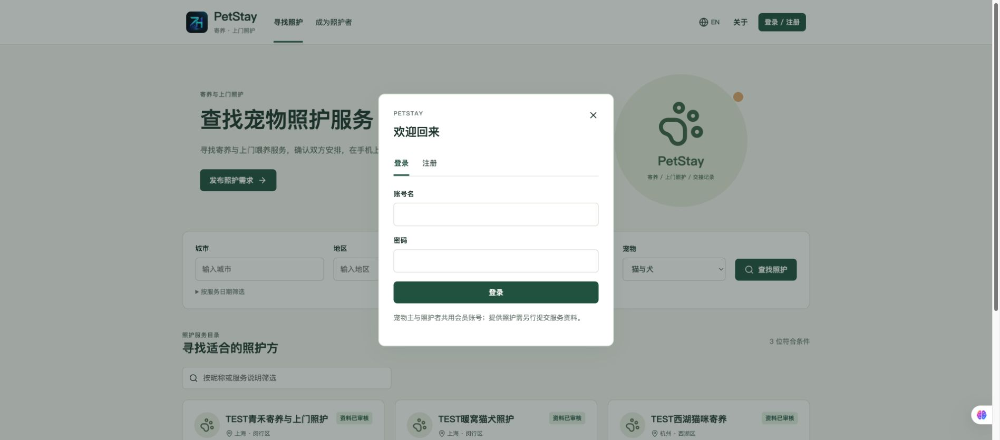

### Service directory — actual filters and reviewed information

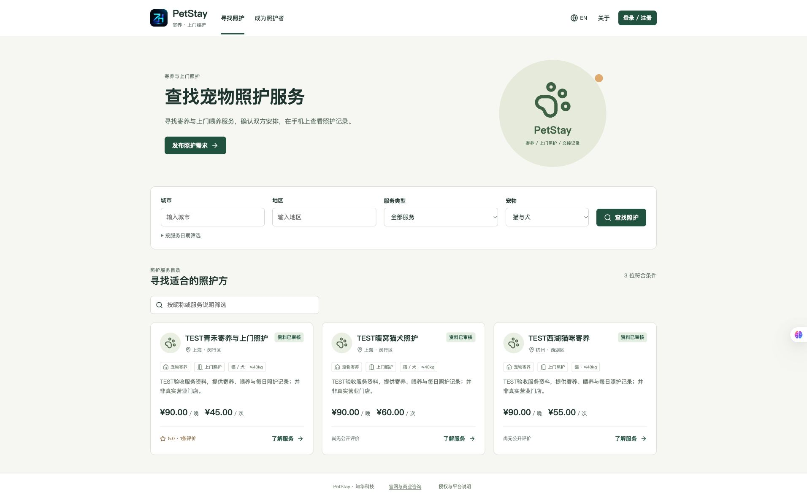

### Pet profiles — species, weight and private care instructions

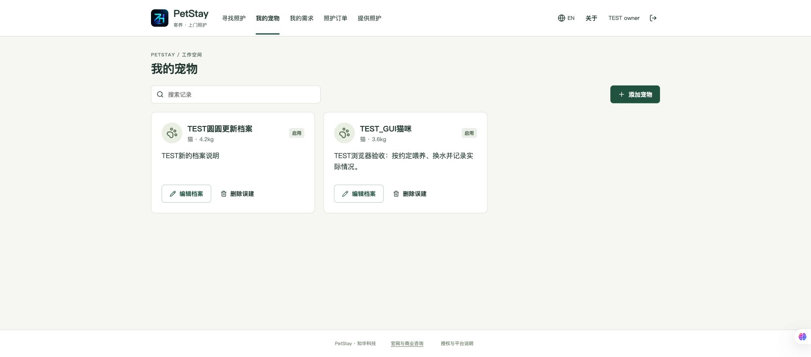

### Request details — matching candidates and actual quotes

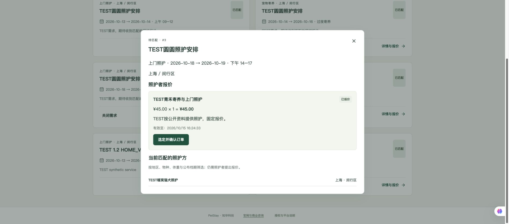

### Care handover — tasks, private photos, history and frozen details

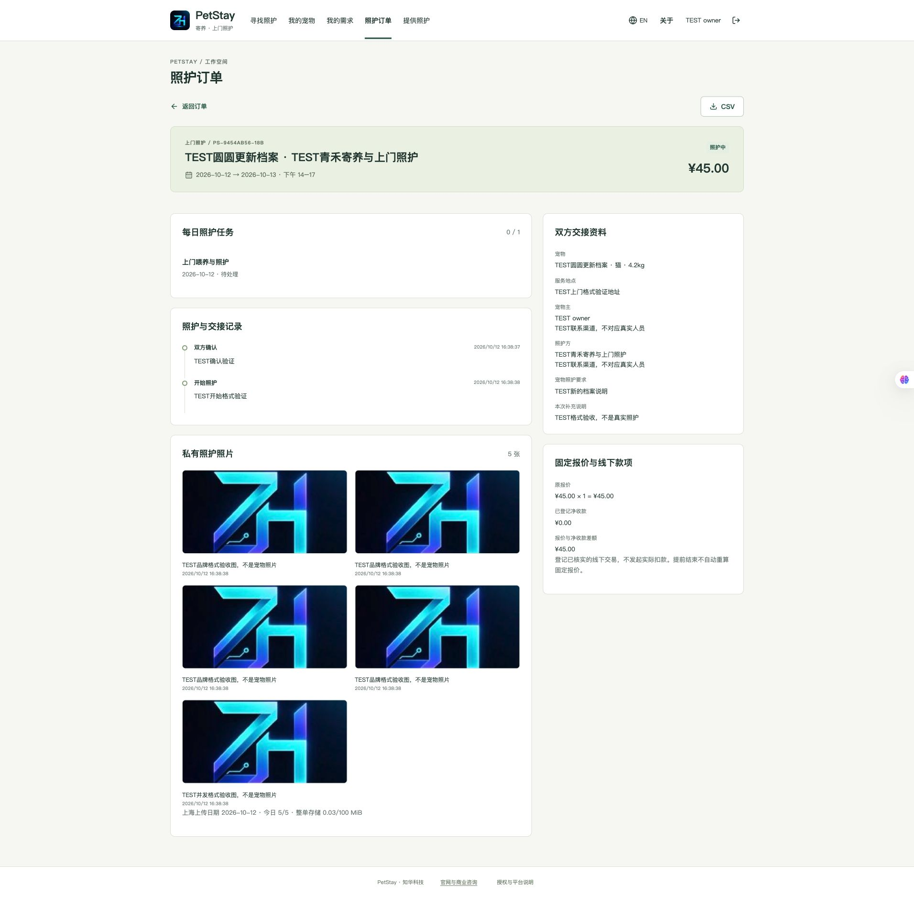

### Operator moderation and reports

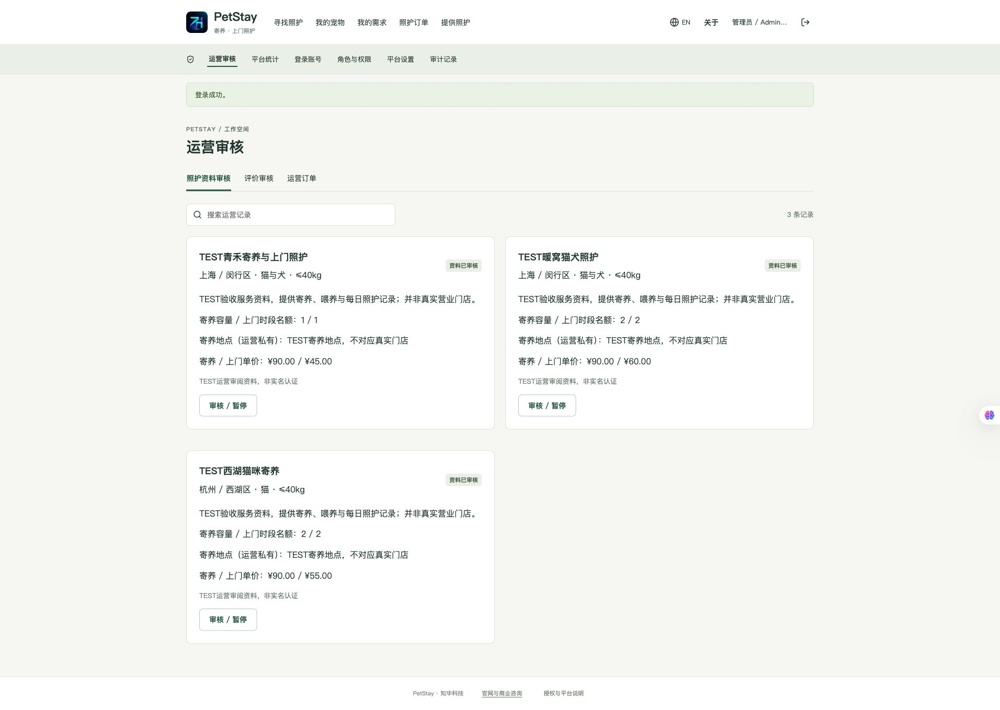

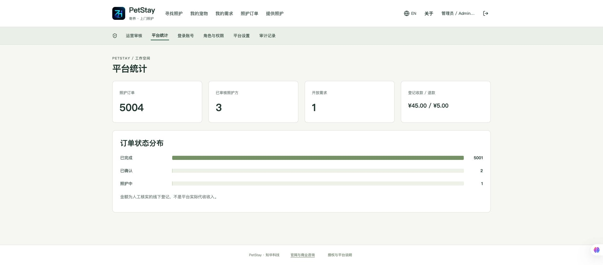

### Roles and system settings

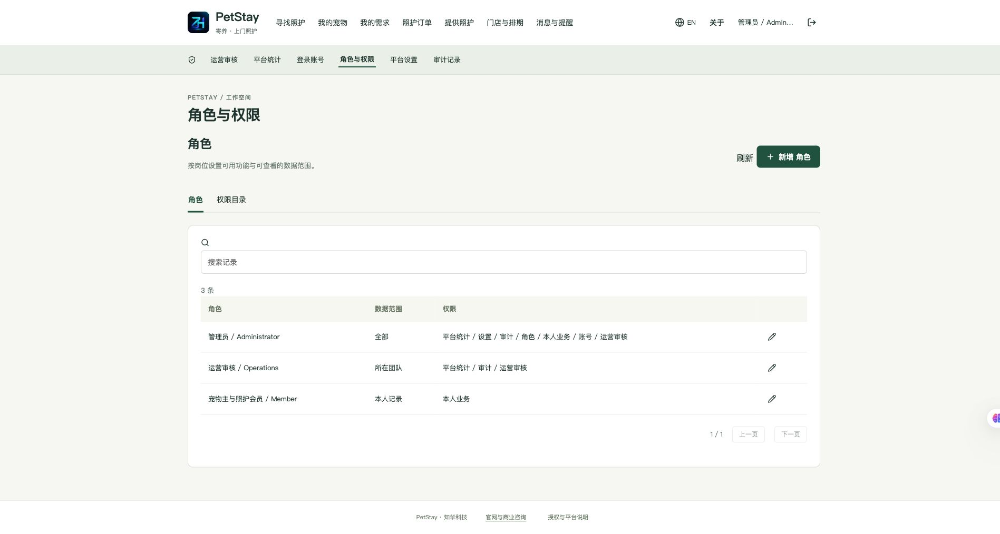

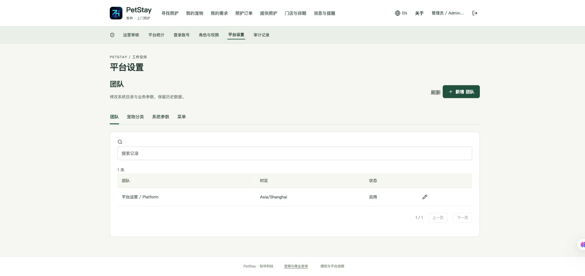

### Mobile H5 — browser viewport 390×844

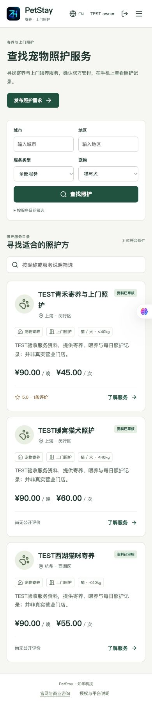

### Order search — authorized database paging

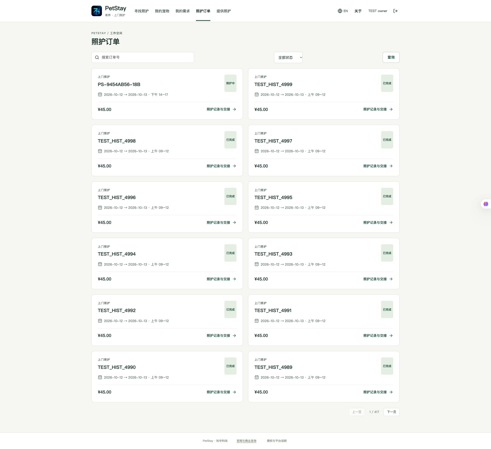

### Shop operations — rosters, daily assignments and employee access

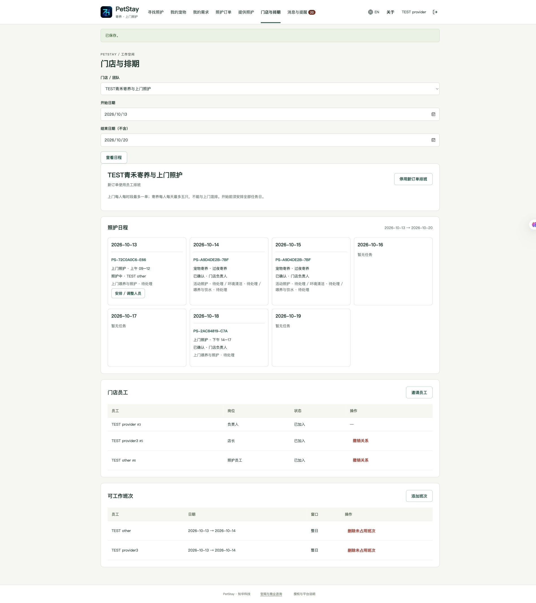

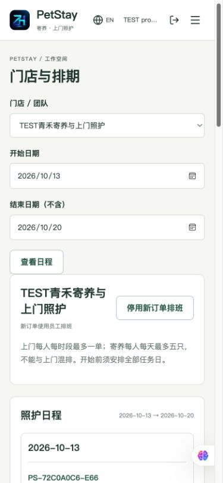

### Notifications — preferences, email verification and a real inbox

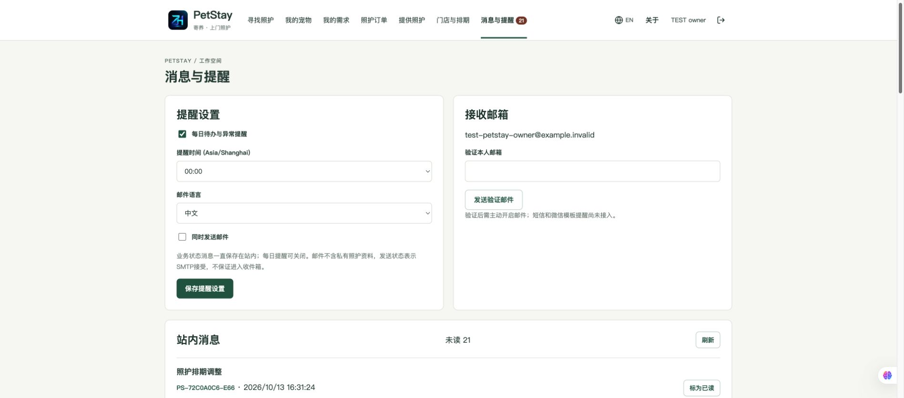

### Carer workspace — assigned tasks and authorized private images

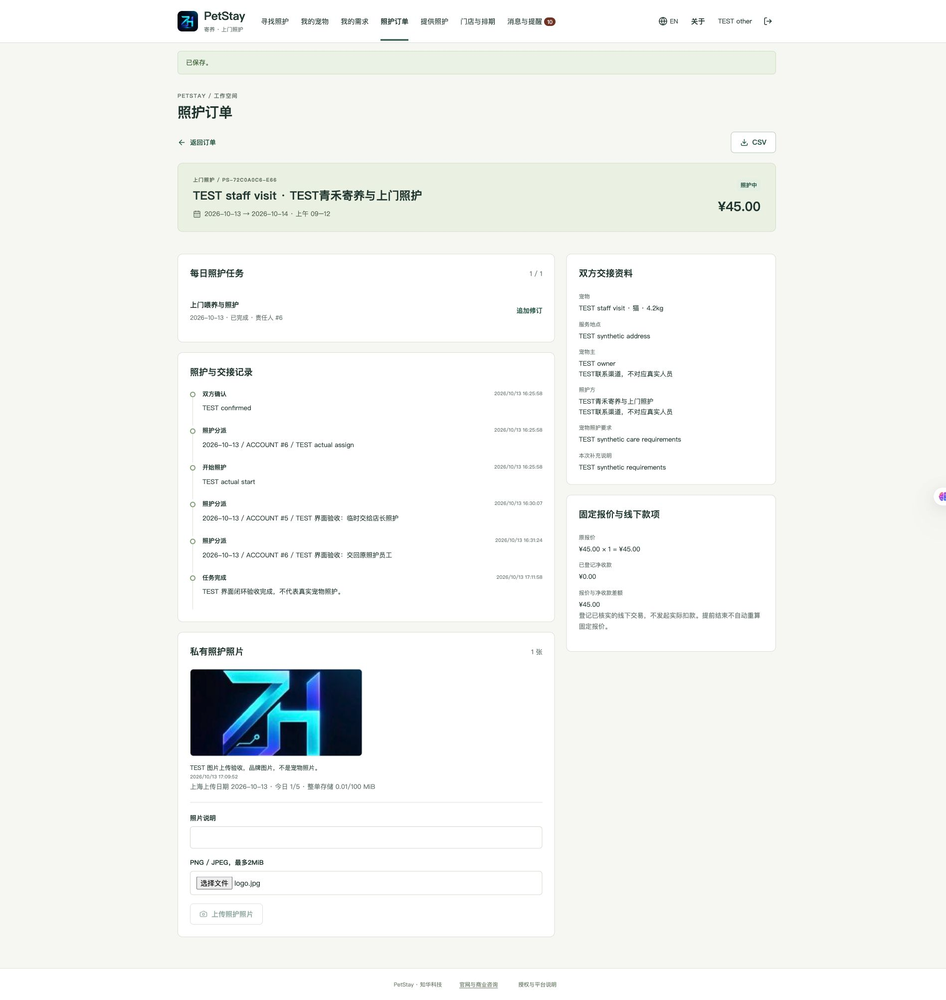

## Architecture and directories

Browser → same-origin Nginx proxy → Spring Boot business/authorization services → MySQL. Flyway applies migrations; JPA validates schema. Care images are decoded, stripped of EXIF and persisted in the database; backups retain images and frozen order snapshots. A platform team-row lock and version checks serialize business writes for one operator, one application instance and low-volume use.

```text
backend/                  Java 21 / Spring Boot 4.0.7, business and identity APIs
  src/main/resources/db/migration/  V1 identity, V2 care, V3 paging, V4 shops and notifications
  src/test/               Rules, permissions, image safety and real HTTP integration
frontend/                 Vue 3.5.43 / Vite 8.1.5, mobile and desktop UI
  public/brand/           Official logo
scripts/                  Environment initialization, tests, backup, isolated restore, release checks
docs/                     Business, API, deployment, security, operations and H5 notes
compose.yaml              MySQL 8.4, backend, Nginx frontend
.env.example              Configuration names without actual credentials
LICENSE / NOTICE          Own non-commercial license / third-party notices
```

## Requirements and startup

Docker Engine, Compose v2 and Python 3.10+; recommended 4 CPU cores, 8GiB RAM and 10GiB free disk. Source development uses Java 21, Maven 3.9+, Node **24.19.0** and npm. First builds require access to official dependency registries.

From the repository root:

```sh
python3 scripts/init-env.py
docker compose -p petstay config --quiet
docker compose -p petstay up -d --build --wait --wait-timeout 1200
```

Open http://127.0.0.1:8136/ ; health: http://127.0.0.1:8136/actuator/health . Initialization refuses to overwrite `.env`. Random passwords stay in the local `.env` (0600), are not printed or committed. Default administrator username is `admin`; read `ADMIN_PASSWORD` locally. **No fixed public password.** Environment values do not reset existing account passwords. Backend builds run tests; frontend builds run formatting, lint, tests and build.

Initializing a new database on slower storage can take several minutes. Startup waits up to 20 minutes; database health checks allow a 10-minute initialization grace period and continue immediately when healthy. This is not a fixed 10-minute delay. On timeout, inspect this project's logs and resolve the cause; do not delete data volumes to retry.

### Database initialization and upgrades

A new MySQL volume creates the database, executes `V1__identity.sql` , `V2__pet_marketplace.sql` , `V3__order_paging_and_photo_allowance.sql` and `V4__shop_operations_and_notifications.sql`, then initializes administrator, roles, permissions, menus, dictionaries and settings. **No fabricated business seed data.** Migrations live at `backend/src/main/resources/db/migration/`; no separate repeatedly executed business initialization script. Back up and test restore before upgrades; add migrations instead of modifying applied versions. Hibernate only validates.

### Configuration

| Variable | Meaning |
|---|---|
| MYSQL_ROOT_PASSWORD / DATABASE_PASSWORD | Unique strong database passwords generated by initialization |
| ADMIN_USERNAME / ADMIN_PASSWORD | Initial administrator; password 12–72 UTF-8 bytes with upper/lowercase and digits |
| WEB_PORT / BIND_ADDRESS | Defaults 8136 / 127.0.0.1; avoid other project ports |
| COOKIE_SECURE | false locally; must be true for public HTTPS |
| MAIL_ENABLED / MAIL_HOST / MAIL_PORT | Email is disabled by default; configure an SMTP server and port before enabling |
| MAIL_USERNAME / MAIL_PASSWORD / MAIL_FROM / MAIL_TLS | Environment-injected account, password and sender; REQUIRED or SSL encryption; NONE only for isolated local tests |
| DATABASE_URL / DATABASE_USER | Optional external MySQL; certificate validation and trusted CA required, see deployment notes |

## Tests and validation

```sh
mvn -B -f backend/pom.xml spotless:check clean verify
cd frontend
npm ci --no-audit --no-fund
npm run format:check
npm run lint
npm test
npm run build
cd ..
python3 -m venv .venv
.venv/bin/pip install -r scripts/requirements-quality.txt
.venv/bin/python -m black --check scripts
.venv/bin/python -m py_compile scripts/*.py
.venv/bin/python -m unittest discover -s scripts -p "test_*.py"
.venv/bin/python scripts/release-check.py
git diff --check
```

Only against an isolated empty TEST instance, with a restricted state file:

```sh
python3 scripts/smoke.py --base http://127.0.0.1:8136 --mode seed --state /private/tmp/petstay-quality-state.json
```

The script verifies registration privilege rejection, matching and quotes, concurrent selection, capacity, snapshots, states, task corrections, private images, disputes, original receipt refunds, reviews and authorization. The state file contains temporary credentials and must never be published. `capture`/`compare` check all visible business data and image hashes across restart and restore; see [validation record](docs/verification.md). Executed 1.2 checks include 49 backend tests, 10 frontend tests, 233 MySQL workflow checks and 230 shop-flow requests/assertions. Actual SMTP rejection/retry and preservation of original V3 data during V4 migration were also checked. See the validation record for restart and restore results. These do not certify public deployment, physical devices or production load.

## Deployment, backup and troubleshooting

[Deployment and restore](docs/deployment.md) covers HTTPS, an independent domain, configuration, private backups and isolated restore. Backups contain private data; the script briefly stops the named backend and retains image bytes. Never upload backups publicly. Weak passwords and port conflicts prevent startup; inspect this project's logs. Registry/network failure should be diagnosed without deleting original data volumes. Sessions expire after 30 minutes or application restart. On version conflict, refresh and review before resubmitting.

Responsive mobile layout is implemented. A prepared public account, HTTPS domain and actual WeChat device verification allow connecting an H5 link. **No public deployment, WeChat login/payment or native mini program has been delivered.** See [mobile H5 and WeChat](docs/wechat-H5.md).

During restore, readiness checks wait up to 15 minutes, polling container health before verifying the application database account. Each probe has a 15-second limit. SQL clients are not repeatedly started during initialization. A timeout retains the isolated restore resources for diagnosis and does not overwrite the source instance.

Optional [dedicated host storage](compose.storage.yaml) uses an existing private data directory selected by `PETSTAY_MYSQL_DATA_DIR`. Pass both Compose files, including repeated `--compose-file` arguments to backup/restore tools. Restore refuses nonempty directories, symlinks and shared volumes. See deployment notes.

## Security and known limitations

BCrypt, HttpOnly sessions, CSRF, live identity/role checks, registration/login throttling, versions and private image/CSV authorization are implemented. Images: ≤2MiB, 6000px edge, 9 million pixels and 5 per order per Shanghai upload date, with 100 MiB per order; existing photos remain. Administrators cannot impersonate either party. See [security](docs/security.md) and [business rules](docs/business.md).

One request covers one cat/dog, one area and one service type. Boarding: 1–30 nights; visits: 1–14 days with one fixed morning/afternoon/evening window per day. Area matching has no GPS distance or AI. Early finish does not recalculate the fixed quote. Legacy orders retain scheduled capacity rules. New boarding occupancy lasts until physical collection, conservatively blocking future capacity while pets remain boarded. No SMS, live chat, online payments/escrow/split settlements, insurance, medical care or identity verification. Order search and paging run in the database (1–50 rows per page). Request/order limits count draft/open requests and unfinished orders; history remains. The member limit still counts all members. Legacy lists, reports and other directories retain a 10,000-row bound; paging is not yet implemented across all modules. Inbox paging is database-backed, but staff relationships are limited to 100 and rosters to 500 per shop. Interrupted delivery leases may repeat email; inbox delivery is not guaranteed. In-memory sessions, a platform write lock and these list boundaries require evaluation before multiple instances or heavy load. Production readiness and real-user operating metrics are unverified.

## License, contributions and feedback

Personal learning and exchange only. Commercial use requires written authorization from Shanghai Rujing Zhihua Information Technology Co., Ltd. **Public source, non-commercial use**; this is not an MIT/Apache free commercial-use license. README, product notice and [LICENSE](LICENSE) agree; third-party rights remain in [NOTICE](NOTICE). No medical, service-quality or commercial operating guarantee. Commercial operation/deployment requires separate authorization.

Use Issues/PRs for reproducible problems with version, steps and sanitized logs; read [AGENTS.md](AGENTS.md) before modifying. Report security issues privately, without posting keys, customer data or exploit details publicly.

## Contact ZhiHua Technology

This public source learning edition supports personal learning, technical research and non-commercial exchange. Commercial licensing, enterprise information systems, SME digital/AI transformation, private deployment, software outsourcing and implementation, FDE outsourcing, OPC support and deep customization are available through ZhiHua Technology.

- Website: [https://www.zhuatech.cn/](https://www.zhuatech.cn/)
- Email: [han@zhuatech.cn](mailto:han@zhuatech.cn)
- Email: [jack@zhuatech.cn](mailto:jack@zhuatech.cn)
- WhatsApp: [+86 17521234993](https://wa.me/8617521234993)

For commercial authorization or deep customization, contact ZhiHua Technology.
